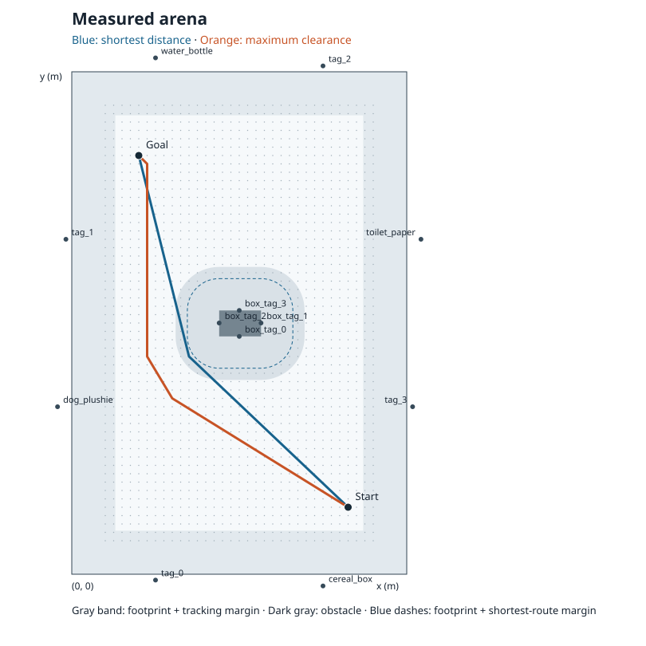
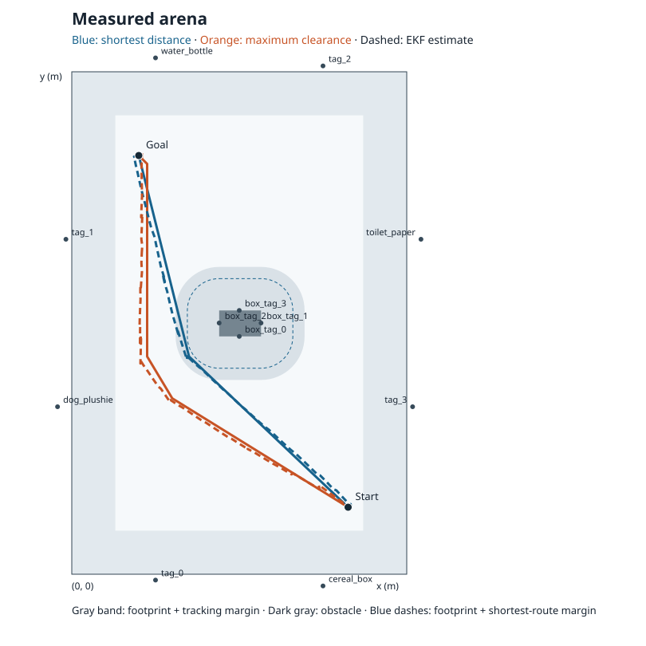

# CSE 276A Homework 4: Path Planning

**Fong-Yu Lin · TSN 200057839**

Distance and safety video links pending.

## 1. Setup and ground-truth map

I planned two ways to drive a rover between diagonally opposite points of an arena with a box in the middle. The distance planner tries to make the trip short. The safety planner gives the rover more room to absorb steering and localization error. Both use the same measured geometry, start, goal, landmark map and controller.

Two parts of my setup are smaller than the assignment asks for. The space I had fits a 2 m × 3 m arena, not 10 ft × 10 ft (3.05 m × 3.05 m). The box is 25 cm × 15.5 cm, below the 1 ft minimum. The narrow arena matters for the results: it leaves two corridors of about 0.88 m beside the box, and both routes end up using the same one (Section 5).

The arena in this figure is 2.000 × 3.000 m. Its origin is the lower-left corner of the plot, with +x right and +y up. The rover position is its turning center. The start pose is (1.650, 0.400, 1.571 rad). The goal is (0.400, 2.500) m. The grid spacing is 0.050 m, the footprint radius is 0.160 m, and the tracking margin is 0.100 m for the safety route and 0.030 m for the shortest route.

| Obstacle | x min (m) | y min (m) | x max (m) | y max (m) |
| --- | ---: | ---: | ---: | ---: |
| center box | 0.880 | 1.420 | 1.130 | 1.575 |

| Landmark | Class | x (m) | y (m) |
| --- | --- | ---: | ---: |
| dog_plushie | dog_plushie | -0.085 | 1.000 |
| water_bottle | water_bottle | 0.500 | 3.083 |
| toilet_paper | toilet_paper | 2.085 | 2.000 |
| cereal_box | cereal_box | 1.500 | -0.070 |
| tag_0 | tag_0 | 0.500 | -0.035 |
| tag_1 | tag_1 | -0.035 | 2.000 |
| tag_2 | tag_2 | 1.500 | 3.035 |
| tag_3 | tag_3 | 2.035 | 1.000 |
| box_tag_0 | tag_0 | 1.000 | 1.420 |
| box_tag_1 | tag_1 | 1.130 | 1.500 |
| box_tag_2 | tag_2 | 0.880 | 1.500 |
| box_tag_3 | tag_3 | 1.000 | 1.575 |

The household objects from HW2 and the AprilTags (36h11) from HW3 provide localization observations. Object locations refer to the centers of their bases, and tag locations to the centers of the printed squares. As in the assignment figure, the tags on the four faces of the box reuse the ids of the edge tags, so the Class column gives the detector label and the Landmark column names each physical instance. I use the camera frame and turning-center convention from HW2. The camera is 12.5 cm ahead of the turning center with a measured yaw offset of about 7° to the left. Heading is positive counterclockwise from +x in the world frame.

*Figure 1. The two plans in the same world frame. The dark rectangle is the obstacle. The light gray area excludes rover centers that would violate the footprint plus the 10 cm tracking margin of the safety route; the blue dashed outline is the same bound with the 3 cm margin of the shortest route. Dots show the free grid samples.*

## 2. Architecture

The measured arena goes to the offline planner and provides the known object positions to the EKF. The planner writes waypoints in meters and radians. On the rover, the camera feeds the HW2 YOLO detector with its range-and-bearing estimator, and the HW3 AprilTag detector, which gets range and bearing from solvePnP. Landmark observations, the IMU yaw rate, and commanded wheel speeds feed the EKF. The waypoint controller uses the pose to turn, drive, stop, and collect new measurements. The pose and observation CSV files record what the estimator and controller did on each run.

**Measured arena → planner → waypoints → waypoint controller → motor board**  
**Camera → YOLO objects and AprilTags → range/bearing → data association → EKF pose → waypoint controller**  
**Known landmark positions, IMU and wheel commands → EKF pose**

I reused known-map localization from HW2 because the landmark positions are available before the run. The planner can therefore compute both routes in the same coordinate frame as the controller. Because two tags share each id, every sighting is matched to the instance of its class with the smallest normalized innovation squared (NIS). If a second instance also passes the chi-square gate (13.8, 2 degrees of freedom), the sighting is skipped instead of guessed. The two instances of an id are more than a meter apart, so with the known start pose the gate separates them. YOLO detections that fall on a recently seen tag are dropped, since YOLO can label a tag's black square as the cereal box. A detection matched to a landmark that, according to the EKF, lies outside the camera's field of view (55° from the camera axis plus a 10° margin) must be a false positive. In the trial run YOLO labeled clutter outside the arena as the cereal box while the real box was behind the rover. Such detections are skipped and do not count toward the consecutive rejections that stop a run. The HW4 navigator stops a run if, according to the EKF, it misses a waypoint by more than the tracking margin, which is the error the planned clearance allows for.

## 3. Representation and search

I represented the floor as an eight-connected grid with extra grid lines through the exact start and goal. Obstacles are axis-aligned rectangles. A circle centered on the rover turning center bounds the rover during a turn. For each edge, the planner computes the smallest distance from the whole line segment to a box or the arena boundary, then subtracts the rover radius. An edge is usable when that clearance meets the tracking margin. Checking the whole segment also catches diagonal steps crossing a corner.

### 3.1 Shortest distance

I used A\* with each edge's length in meters as its cost and the straight-line distance to the goal as the heuristic. Straight-line distance lower-bounds the cost of any remaining path in the graph, so the first goal popped by A\* gives the shortest graph route. Distance is the planning objective. The rover's elapsed time also depends on its stops, turns, and localization updates. To make the trade-off between the two objectives visible, the shortest route may keep a smaller margin than the safety route (the setup paragraph gives both). The waypoint tolerance on the rover stays at the full tracking margin for both runs.

### 3.2 Maximum safety

I maximized the route's smallest clearance (a maximin, or widest-path, problem). The start and goal are given by the task, and here the start sits close to the arena edge. Judged by plain clearance, the start itself would be the bottleneck of every route, and the safety route would collapse onto the shortest one. I therefore judge each point by its clearance only where it is worse than the start or goal forces: a point at distance d from an endpoint may be as close as that endpoint's clearance plus 0.5 d. A route leaving a corner diagonally gains clearance at 1/√2 per meter, so this rate is always achievable, while a route that keeps hugging a wall soon falls below it. Points within this allowance do not limit the route; elsewhere a point counts with its clearance, sampled every centimeter along each edge.

Each edge gets the smallest such clearance along it, and a max-priority search finds the route whose worst edge is best. A candidate path inherits the smaller of its current value and the next edge's value, so the first goal popped gives the largest attainable value in the graph. I then ran the length-based search again using only edges meeting that value. This chooses the shortest graph route among equally safe routes. All edges of both routes also keep the tracking margin.

For both routes, I reduced the number of stops by joining vertices along the original path with straight segments. Each new segment passes the same continuous clearance check and meets the respective planner threshold. A shortest-distance tie break selects among waypoint sequences with the same number of legs. The final figures and table refer to the exported waypoint polylines.

## 4. Results

| Plan | Distance (m) | Minimum clearance (m) | Obstacle clearance (m) | Drive legs |
| --- | ---: | ---: | ---: | ---: |
| Distance | 2.546 | 0.044 | 0.044 | 2 |
| Safety | 2.747 | 0.190 | 0.270 | 4 |

Clearance is measured from the edge of the modeled circular footprint. Minimum clearance includes the arena boundary, which is set by the start and goal; obstacle clearance counts the box only. In the executed comparison I use the EKF center samples to estimate distance, clearance and cross-track error. The command span runs between the first and last logged nonzero wheel commands, including any intervening stops. Tape measurements at the final stop and observations from both videos are used to assess physical performance.

*Figure 2. Planned routes (solid) and EKF estimates of the rover center during the two recorded runs (dashed).*

| Run | EKF distance (m) | EKF min. clearance (m) | EKF obstacle clearance (m) | Command span (s) | EKF goal error (m) | Max. cross-track error (m) | Sightings used / rejected |
| --- | ---: | ---: | ---: | ---: | ---: | ---: | ---: |
| Distance | 2.855 | 0.057 | 0.057 | 15.10 | 0.027 | 0.035 | 61 / 0 |
| Safety | 3.189 | 0.182 | 0.307 | 22.19 | 0.024 | 0.056 | 55 / 2 |

Physical stop error, tape-measured in a straight line from the goal mark to the rover center: 4 cm for the distance run and 1 cm for the safety run. The EKF put the final positions 2.7 cm and 2.4 cm from the goal, so in both runs the estimate and the tape agree to within about 1.5 cm. Contact with the box: **[none in either run — confirm from the videos]**.

Both runs completed without an abort, and the EKF trajectories stay within 3.5 cm (distance) and 5.6 cm (safety) of the planned polylines. The estimated clearance to the box was 5.7 cm on the shortest route and 30.7 cm on the safety route, close to the planned 4.4 cm and 27.0 cm. The safety route was 8% longer on paper (2.747 m against 2.546 m) but took 47% longer to drive (22.2 s against 15.1 s). Its four legs cost three extra turn-and-look stops, and every stop includes 1.5 s of standing still for landmark sightings, so in this controller the number of legs matters more for time than the length does.

The EKF distance column is longer than the planned length (2.855 m against 2.546 m, 3.189 m against 2.747 m) because each landmark update moves the estimate by a few centimeters and the 10 Hz log adds up those jumps. It measures how much the estimate moved, not how far the wheels went.

Localization was stable in both runs: 61 of 61 and 55 of 57 fused sightings passed the gate. The two rejections in the safety run were dog_plushie detections. The visibility check skipped 4 and 9 detections that matched a landmark outside the camera's field of view, mostly a cereal_box label on clutter beyond the top-left corner of the arena. In the first trial, before this check existed, three such detections in a row stopped the run during its final stop.

## 5. Discussion

The two objectives answer different questions. Length-based search trades clearance for a shorter path until it reaches the chosen margin. Maximin search values the tightest point on the route and can add distance or turns to give that point more room.

In this arena the two routes are closer than I expected. With the same 10 cm margin on both, I first recorded a shortest route that passed the box at 11.2 cm, against 30.7 cm for the safety route, and the two paths were never more than 33 cm apart. Maximin only improves the tightest point. Here that point is the corridor beside the box, so the safety route moves to the middle of the corridor and otherwise follows the shortest path, which runs through the same left corridor. Moving the box would not separate them either: the straight line from start to goal always passes on the wider side of the box, which is also the side the safety planner prefers. I also tried a cost of length × (1 + k / clearance), which rewards clearance everywhere instead of at the bottleneck. With k from 0.1 to 1.0 it still chose the left corridor, at 23–27 cm from the box, and only added length. To make the trade-off visible I lowered the margin of the shortest route to 3 cm, which moves its turn 10 cm closer to the box corner.

The endpoint allowance in Section 3.2 was necessary. Without it, the start (19 cm from the right edge after the footprint) set the bottleneck at 19 cm, and the safety route followed the shortest one to within 5–8 cm.

The clearance computation assumes stationary obstacles and a measured arena, and the circular footprint is conservative, since the rover's sides are closer to its center than its corners are. The controller relies on its pose estimate, so a planned clearance of a few centimeters is only as good as localization. Here the EKF reached each waypoint within about 2–5 cm, but one landmark was biased: the water bottle read about 16 cm short at 2.9 m, beyond the 2 m range the HW2 detector was calibrated for. A planner that knew the estimate's covariance could widen the margin where localization is weak, for example far from the box tags.
